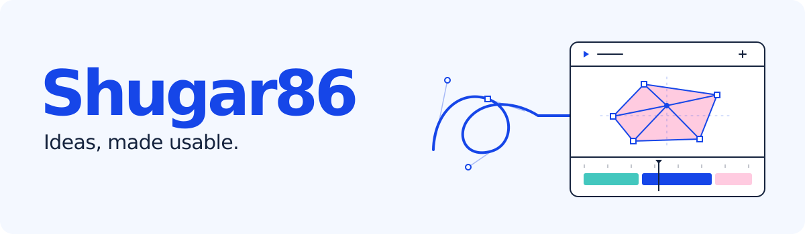

<picture>
  
</picture>

[English](README.md) · **Русский**

Я **Shugar86**, solo-разработчик. Создаю AI-агентов, творческие инструменты и веб-продукты. Мне интересно, что человек и модели могут сделать вместе: полезный инструмент, понятный рабочий процесс или идею, которую хочется развивать.

[Избранные проекты](#избранные-проекты) · [Как я работаю](#как-я-работаю) · [Предложить идею](https://github.com/Shugar86/Shugar86/issues)

## В центре внимания: Vids Studio

### [Создавайте видео в Google Vids с Codex или Claude Code](https://github.com/Shugar86/vids-studio)

Опишите аудиторию, историю и материалы. Агент работает в документе Vids, который вы явно подключили; видео остаётся редактируемым в исходном редакторе.

**Творческие навыки + локальный MCP-коннектор + расширения Chrome.** Отдельные пакеты для Codex и Claude Code, инструкции на русском и английском.

**Windows · macOS · Linux** &nbsp; | &nbsp; **MIT** &nbsp; | &nbsp; **v0.3.0 preview**

[Скачать](https://github.com/Shugar86/vids-studio/releases/tag/v0.3.0) · [Установка](https://github.com/Shugar86/vids-studio/blob/main/docs/ru/platforms.md) · [Как устроено](https://github.com/Shugar86/vids-studio/blob/main/docs/ru/architecture.md) · [Исходники](https://github.com/Shugar86/vids-studio)

  

**[Смотреть: «Саша и лампа · Claude v5»](https://shugar86.github.io/vids-studio/ru/)** — выбранный автором вариант на 45,5 секунды, собранный в Google Vids с Claude Code. Озвучка на русском; в плеере доступны английские субтитры. [Что изменилось и что проверено](https://github.com/Shugar86/vids-studio/blob/main/docs/ru/demo.md).

Нужен собственный доступ к Google Vids. <a href="https://github.com/Shugar86/vids-studio/actions/runs/39673003140">Нативные проверки v0.3.0 пройдены</a>. Для текущего деморолика выполнена проверка MP4; живая приёмка автоматического процесса экспорта остаётся отдельной задачей. <a href="https://github.com/Shugar86/vids-studio/blob/main/docs/ru/testing.md">Что проверено</a>.

## Избранные проекты

| Проект | Что внутри |
| :--- | :--- |
| **[VibeCraft](https://github.com/Shugar86/vibecraft-manifest)** | Философия и инженерный ориентир для соавторства человека и моделей: общий замысел, взаимодействие, игра и красота. **RU / EN** |
| **[AI Pair Programming](https://github.com/Shugar86/ai-pair-programming-guide)** | Практический курс: от настройки инструментов до реальных проектов, ревью и работы с несколькими агентами. **RU / EN** |
| **[My Agent](https://github.com/Shugar86/my-agent)** | Платформа бизнес-агентов: роли, навыки, память, интеграции и визуальные рабочие процессы. |
| **[REVERSCAD](https://github.com/Shugar86/reverscad)** | Инструменты обратного проектирования: анализ STL-сканов, восстановление параметрической геометрии и экспорт STEP. |
| **[Methodist Agent](https://github.com/Shugar86/methodist-agent)** | Помощник для учебных документов: Word, Excel, PowerPoint и PDF с интеграцией в Windows. |

<strong>Ещё проекты: веб, автоматизация, геометрия и практические материалы</strong>

### Веб-продукты

- **[MagikBook](https://github.com/Shugar86/magikbook)** и его **[API](https://github.com/Shugar86/magikbook-api)** — сообщество для обмена промптами и его бэкенд.
- **[Coffeeman](https://github.com/Shugar86/coffeeman)** — магазин кофе и чая с системой управления контентом.
- **[Pulse Chat](https://github.com/Shugar86/pulse-chat)** — проект мессенджера с чатами и WebRTC-звонками.

### Автоматизация и данные

- **[PriceDesk](https://github.com/Shugar86/ecommerce-price-analytics)** — сбор, нормализация и анализ B2B-прайсов.
- **[Weather Trip Scout](https://github.com/Shugar86/weather-trip-scout)** — подбор направлений для поездок поблизости с учётом погоды.
- **[Social AI Engine](https://github.com/Shugar86/social-ai-engine)** — инструменты для подготовки контента и публикаций в соцсетях.
- **[Sales Bot Engine](https://github.com/Shugar86/sales-bot-engine)** — оркестратор диалогов для продаж с разными ролями.
- **[Netvork Market Channel](https://github.com/Shugar86/netvork_market_channel)** — проект контент-агента для Telegram.

### Геометрия, документы и руководства

- **[Additive Light](https://github.com/Shugar86/additive-light)** — исследовательский проект генеративного 3D-моделирования и превращения сканов в параметрические модели.
- **[astro-calc](https://github.com/Shugar86/astro-calc)** — HTTP-сервис расчётов на Swiss Ephemeris без хранения состояния.
- **[DocBrain](https://github.com/Shugar86/docbrain-public)** — публичное описание сервиса, примеры писем и практические материалы; исходного кода приложения в этом репозитории нет.
- **[US Demand Letter Guide](https://github.com/Shugar86/us-demand-letter-guide)** — краткое руководство по структуре претензионного письма в США, срокам и подтверждению отправки.
- **[Pelvic Floor Bot](https://github.com/Shugar86/pelvic-floor-bot)** — проект информационного навигатора с Telegram-ботом, лендингом и PDF-руководством.

Здесь есть продукты, прототипы, исследования и документация. Назначение, состояние и порядок запуска описаны в README каждого проекта.

## Как я работаю

**Начинаю с опыта человека.** Что он сможет сделать, понять или почувствовать?

**Работаю с AI как с напарником.** Проясняю замысел, оставляю место для суждения и проверяю результат.

**Довожу полезную часть до конца.** Работающее изменение, проверка, понятная документация и честные границы результата.

Использую **Python, TypeScript, React, Next.js, FastAPI, Node.js, Bun, PostgreSQL, Docker и Linux**.

---

Нашли полезный проект? Звезда помогает другим его заметить. Обратную связь и воспроизводимые проблемы можно оставить в Issues соответствующего репозитория. Пишите по-русски или по-английски.

[Все публичные репозитории](https://github.com/Shugar86?tab=repositories) · [Идеи для профиля](https://github.com/Shugar86/Shugar86/issues) · [English](README.md)
